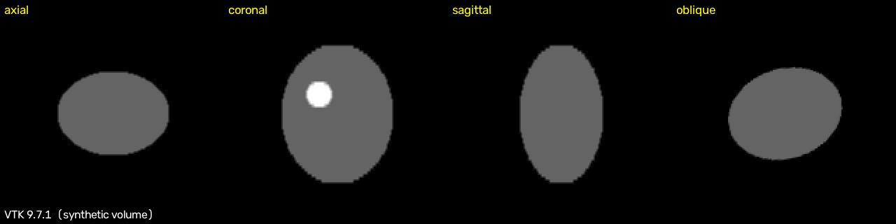
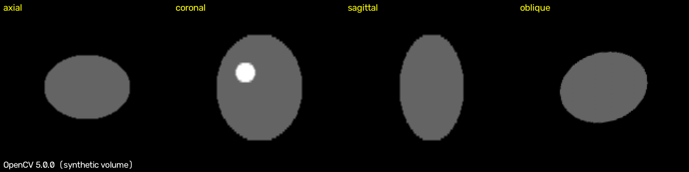

# Multi-Planar-Medical-Image-Reconstruction

Multi-planar reconstruction (MPR) in C++: from one 3D volume, extract the **axial, coronal, sagittal** slices (and an **oblique** one in the VTK version). Two versions: **VTK 9** (`vtkImageReslice`) and **ITK 5** (`ExtractImageFilter`).

> Status: example code, not validated on clinical data. Not for clinical use.

## Result (synthetic test volume)
The test volume is 96 x 96 x 64 voxels with spacing 1 x 1 x 2 mm, containing an ellipsoid, a bright sphere and a box. No patient data is used.
- `mpr_result.png` (VTK): axial | coronal | sagittal | oblique
- `itk_result.png` (ITK): axial | coronal | sagittal

The slices show the expected shapes, and the sphere appears at the correct side and height in the coronal view. The ITK reader was also tested on a synthetic DICOM series (64 files) and gave the same images as the built-in volume.

## Build and run
```
mkdir build && cd build
cmake .. && make
./mpr_slicer                    # VTK, synthetic volume
./mpr_itk                       # ITK, synthetic volume
./mpr_itk path/to/dicom_dir     # ITK, your own DICOM series (folder)
./mpr_slicer path/to/dicom_dir  # VTK, your own DICOM series (folder)
```
Requires CMake and VTK 9 and/or ITK 5 (each version is built if its library is found). Tested with VTK 9.1 and ITK 5.3. Output: `axial.png`, `coronal.png`, `sagittal.png`, `oblique.png` (VTK) and `itk_axial.png`, `itk_coronal.png`, `itk_sagittal.png` (ITK).

## How it works
**VTK:** load a DICOM series (`vtkDICOMImageReader`) or build a test volume, define each plane by a 4x4 matrix (plane axes and volume centre), reslice with linear interpolation (`vtkImageReslice`), scale to 8 bit and write PNG.

**ITK:** read the DICOM series (`GDCMSeriesFileNames`, `ImageSeriesReader`), extract the middle slice of each axis (`ExtractImageFilter`), resample to square pixels, flip so z points up, scale with the grey range of the whole volume and write PNG.

## Notes
- With a real DICOM series, image orientation is not corrected yet: the code uses the voxel axes, not the patient coordinate system.
- Never upload patient DICOM data to a public repository.

## Use and contact
If you use, adapt or contribute to this work, please credit the author and **contact or inform me by email: owaiskhan_bangash@yahoo.com**

## Author
BEN, Software Engineer. GitHub: [Bangash514](https://github.com/Bangash514)

## Python versions (VTK, ITK, OpenCV)

Same synthetic volume and the same four planes (axial, coronal, sagittal, oblique) in three Python libraries. Each script writes a picture and the raw slices.

```bash
pip install numpy opencv-python vtk itk
python3 python/mpr_vtk.py       # VTK 9, vtkImageReslice
python3 python/mpr_itk.py       # ITK 5, ResampleImageFilter
python3 python/mpr_opencv.py    # OpenCV only: trilinear sampling from cv2.remap
python3 python/compare_mpr.py   # pixel-by-pixel comparison
```





Tested with VTK 9.7.1, ITK 5.4.7, OpenCV 5.0.0. The three libraries give the same slices on this volume (see `results/py_compare.txt`). Synthetic data only; the older `Slicer.py`, `ImageSlicer.py` and `slicer.cpp` are separate earlier work.
